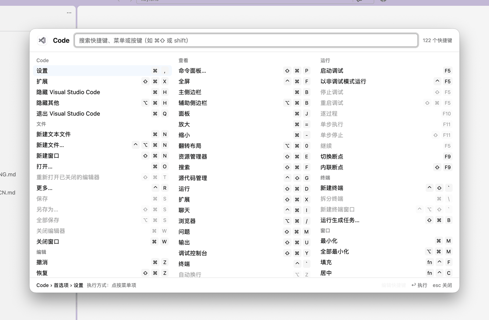
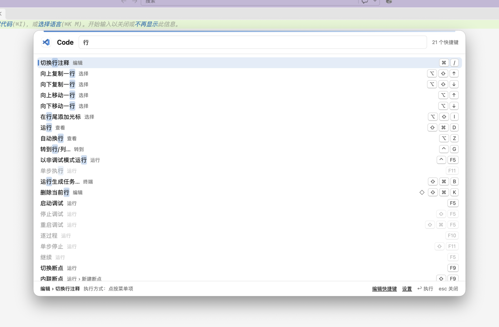
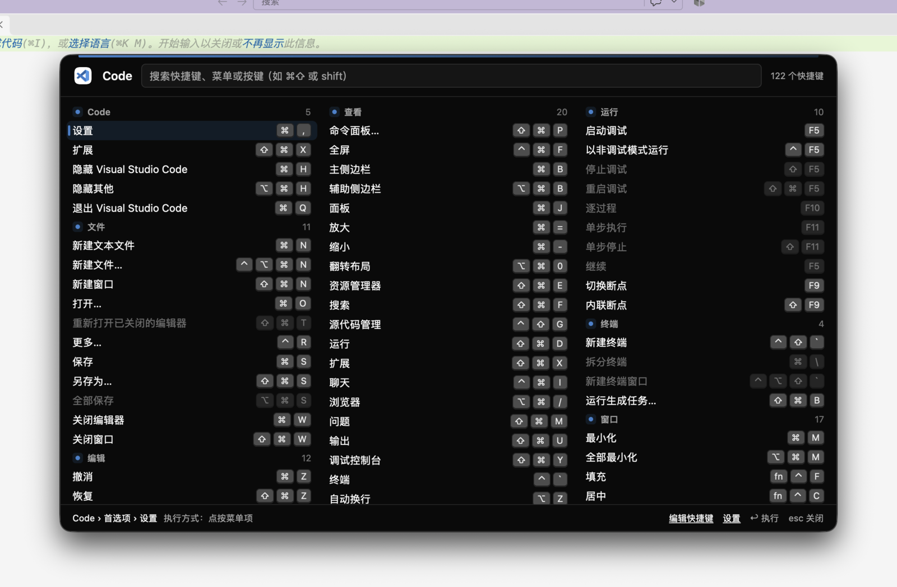

# Keylens

[English](README.md) · **简体中文** · [主页](https://wenlingang.github.io/keylens/)

长按 ⌘，看清当前应用的所有快捷键：可以搜索，也可以直接执行。开源、跨平台，快捷键数据由社区维护。基于 [gpui-kit](https://github.com/longbridge/gpui-kit) 构建。

> **状态：** v0.1，目前仅支持 macOS（Universal 版本，Apple Silicon + Intel；Intel 版本未经真机验证）。Windows 和 Linux 在路线图上。

<p align="center">
  
</p>

## 看一眼

**想不起快捷键？按住 ⌘ 就行。** 按住时会有一颗小键帽慢慢蓄满，满了就弹出浮层。浮层直接读取前台应用的菜单，不需要为每个应用单独配置。上图是 VS Code，换成 Zed、Notion、Slack 也是同样的用法。每个应用都会让浮层换上它图标的颜色。

**用字搜，也能用键搜。** 输入「行」能找到所有和行相关的操作；输入 `⌘⇧` 则列出所有用到 Command + Shift 的快捷键，不用管修饰键的顺序，对应的键帽会亮起来。选中后按回车，键帽依次按下，Keylens 替你执行。

**深色模式不用管。** 浮层跟随系统外观，白天晚上看着都顺眼。

<p align="center">
  
  
</p>

## 功能

- **长按 ⌘ 呼出**：浮层显示前台应用的全部菜单快捷键，按菜单分列；松开 ⌘ 后浮层保持显示。
- **蓄力动画**：按住时一颗动漫风的 ⌘ 键帽被应用的颜色灌满。⌘C 这类一按就松的快捷键不会触发；系统开启「减弱动态效果」时不显示。
- **应用的颜色**：浮层取前台应用图标的主色，快捷键以键帽样式显示。
- **搜索**：按标题、菜单路径或按键搜索，支持 `⌘⇧`、`shift`、`cmd+shift+p` 等写法，不区分修饰键顺序。
- **直接执行**：单击选中，双击或回车执行。菜单项直接点按，社区数据里的快捷键通过模拟按键执行。
- **社区快捷键数据**：补充菜单里读不到的快捷键（例如 VS Code、Chrome、Slack），用 ◇ 标记。同时会读取 VS Code、VS Code Insiders、Cursor 的用户 `keybindings.json`（仅默认配置文件），改动约 2 秒内生效，自己新增的命令会出现在「我的自定义」分组下。
- **补充自己的快捷键**：在面板底栏或菜单栏选择「编辑快捷键」，直接按下组合键录入，保存到你的数据目录，2 秒内显示在面板中。
- **键盘操作**：↑↓←→ 移动，Esc 先清空搜索、再关闭浮层。
- **多语言界面**：简体中文、English、繁體中文、日本語，默认跟随系统语言。
- **深色 / 浅色**：跟随系统外观。

## 安装

1. [下载最新的 Keylens.dmg](https://github.com/wenlingang/keylens/releases/latest/download/Keylens.dmg)（或在 [Releases](https://github.com/wenlingang/keylens/releases) 选择版本），打开后把 **Keylens** 拖进「应用程序」。请不要直接在 dmg 里运行。
2. Keylens 未经 Apple 公证，第一次打开会被拦下。任选一种方式放行：
   - 打开「系统设置 › 隐私与安全性」，在底部点「仍要打开」；
   - 或在打开 dmg 之前，在终端执行：`xattr -d com.apple.quarantine ~/Downloads/Keylens.dmg`（新版 macOS 不允许终端修改「应用程序」里已有的 App）
3. 按引导在「系统设置 › 隐私与安全性 › 辅助功能」中打开 Keylens 的开关，授权后自动生效。之后升级覆盖安装，不需要重新授权。

Keylens 每天会检查一次新版本，也可以在菜单栏图标的菜单里点「检查更新…」手动检查。发现新版本时会先询问，确认后自动下载、安装并重启。只有用同一张证书签名的新版本才会被安装，所以辅助功能授权会保留。

支持 macOS 11 及以上，Universal 版本（Apple Silicon + Intel）；目前只在 macOS 26（Apple Silicon）上实测过，Intel 版本未经真机验证。

## 从源码构建

需要 Rust（支持 edition 2024 的版本）。目前只在 macOS 26（Apple Silicon）上验证过。

```bash
# 一次性：创建本地开发签名证书（会弹出系统密码框）
scripts/dev-cert.sh

# 编译、打包并启动
scripts/run-dev.sh
```

第一次启动后，在「系统设置 › 隐私与安全性 › 辅助功能」里添加 `target/dev-apps/KeylensDev.app`（菜单栏图标显示 `⌘dev`）并打开开关。授权后自动生效，不需要重启；之后重新编译也不需要再次授权。

## 配置

在菜单栏「⌘」图标的菜单里选择**设置…**，或者在面板打开时按 ⌘,，就能打开设置窗口。可以选择唤出方式（长按或双击）、使用的修饰键、长按时长或双击间隔、长按时松开按键是否关闭面板，以及界面语言。修改立即生效。

设置保存在 `~/.config/keylens/config.toml`（Linux 上是 `$XDG_CONFIG_HOME/keylens`），也可以手动编辑。设置窗口保存时会保留你写的注释，手动修改的内容 2 秒内生效：

```toml
# 覆盖系统语言：zh-CN、zh-TW、zh-HK、en、ja
language = "ja"

[trigger]
mode = "hold"          # hold | double-tap
key = "cmd"            # cmd、option、ctrl、shift（也认 super、alt、win、control）
hold-ms = 800          # 300–2000
double-tap-ms = 350    # 200–600
hide-on-release = false  # 仅长按：松开按键时关闭面板
hold-animation = true    # 仅长按：按住时显示按键蓄力动画

[update]
auto-check = true      # 每天自动检查一次新版本
# skip-version = "0.2.0"  # 更新弹窗里点「跳过此版本」时写入
```

自己补充的快捷键数据放在 `~/.config/keylens/apps/*.toml`，格式与内置数据相同，会覆盖内置数据中同一应用的同一快捷键。菜单栏「⌘」图标的菜单里可以直接打开这个目录。也可以在窗口里编辑：点面板底栏的「编辑快捷键」。

## 目录结构

- `crates/keylens-core/`：平台无关的核心逻辑（快捷键模型、合并、搜索、触发判断、多语言、社区数据）
- `crates/keylens-platform/`：平台接口
- `crates/keylens-macos/`：macOS 实现（辅助功能 API、按键监听、浮层窗口、菜单栏图标）
- `crates/keylens-app/`：gpui-kit 界面与控制逻辑
- `data/apps/`：社区快捷键数据（CC0）
- `spikes/`：一次性技术验证代码，不属于产品

## 参与贡献

欢迎补充快捷键数据和改进代码，见 [CONTRIBUTING.md](CONTRIBUTING.md)。

```bash
cargo test --workspace
cargo clippy --workspace --all-targets -- -D warnings
```

## 授权

代码使用 Apache-2.0，`data/` 目录下的数据使用 CC0 1.0。
